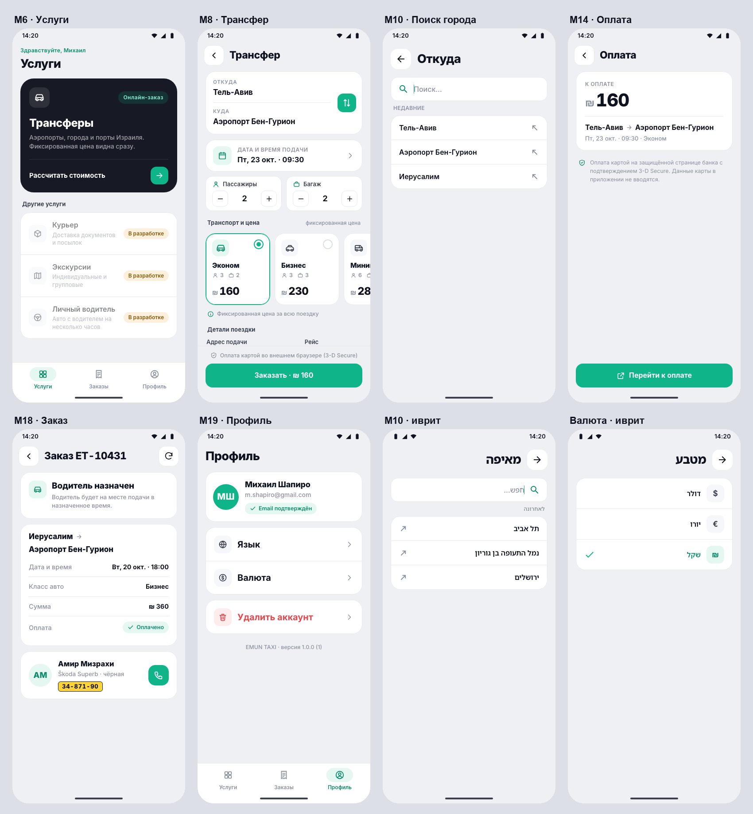

# EMUN TAXI — HTML-прототип Android-приложения

Кликабельный прототип по ТЗ по экранам «EMUN TAXI v3.6» (20.09.2026). Визуал построен на дизайн-системе
Emun Drive из проекта EmunTaxiPrices: Figma `Emun Taxi Meter — Redesign`, node `1041-2`, и
`figma-export/modern/emun-modern.css`. Бэкенда нет, все данные локальные.

**Объём (упрощён 19–20.10.2026):** на экранах только минимально необходимые данные; в трансфере — маршрут, дата/время, тариф и цена на кнопке. вход и регистрация (без гостевого режима), трансферы с оплатой, заказы,
а в профиле — «Язык», «Валюта» и удаление аккаунта. Остальные услуги на главном экране в статусе
«В разработке» и не нажимаются. Документы (M21), поддержка (M22), выход из аккаунта и шиты услуг через
оператора убраны. Поиск города (M10), выбор языка (M20) и валюты повторяют приложение таксометра
(EmunTaxiPrices: `CityScreen`, `MenuScreen`, `LanguageScreen`, `CurrencyScreen`).



## Как открыть

- **Двойной клик по `index.html`.** Сервер не нужен, прототип работает офлайн, шрифты лежат в проекте.
- Через локальный сервер, чтобы открыть с телефона в той же Wi-Fi-сети:
  ```bash
  python3 -m http.server 8130 --directory /Users/roman/Desktop/EnumDriver
  ```
  Затем откройте на телефоне `http://<IP-мака>:8130`. На телефоне приложение занимает весь экран
  с учётом safe-area, а панель прототипа открывается ручкой у левого края.
- **Во встроенном браузере Claude** и в любом окне уже 900 px панель прячется: кнопка «Экраны» в верхней
  строке (и на доске «Все экраны») открывает её как выезжающее меню. Esc закрывает меню.

- **Приватная ссылка (claude.ai Artifact):** https://claude.ai/artifact/MLf5hTiK1d6hu329kdLmJN
  Её публикует `artifact.html`: та же страница без `<html>/<head>/<body>`, обёртку добавляет хостинг.
  При изменениях обновите и `index.html`, и `artifact.html`, а затем опубликуйте заново по этой ссылке.
  Доступ заказчику выдаётся через меню Share на странице. В артефакте не работают параметры `?lang=`
  и `?sys=1`, язык переключается в панели.

### Панель прототипа (на десктопе)

- **Устройство / Все экраны.** Интерактивное Android-устройство или доска со всеми 66 состояниями.
  Клик по миниатюре открывает это состояние на устройстве.
- **Язык:** иврит (RTL), русский, английский. Переключается в панели или в приложении: «Профиль» → «Язык».
- **Размер экрана:** 360×800, 390×844 (как в Figma) или 412×915.
- **Сценарии:** первый запуск, «оформление и оплата», «заказы и статусы».
- **Сеть и сбои:** «нет интернета» и разовые ошибки (расчёт цены, ссылка на оплату, заказ не создан,
  справочник, удаление аккаунта).
- Esc работает как системная кнопка «Назад». Кнопка «Назад» в браузере на телефоне тоже работает.
- Прямые ссылки на состояния: `index.html#m8`, `index.html#overview`, `?lang=he`.

### Тестовые данные

| Ввод | Результат |
|---|---|
| `m.shapiro@gmail.com` (или любой корректный email) | вход в существующий аккаунт с историей заказов |
| email со словом `new` / `limit` | «аккаунт не найден» / лимит отправок (M2) |
| email со словом `fail` при регистрации | ошибка отправки кода (M5) |
| код из письма `000000` / `111111` / `222222` | неверный / истёк / уже использован; любой другой код из 6 цифр подходит |
| страница 3DS | ответ банка можно выбрать: успех, отказ, нет ответа; «Отменить» — это отмена 3DS |
| «Обновить» в карточке нового заказа | имитация действий оператора: подтверждён → водитель назначен → завершён |

## Реализованные экраны

| Экран | Состояния |
|---|---|
| M1 Сплэш | один вариант — первый запуск: логотип и индикатор, затем M2 |
| M2 Вход по email (вместе с бывшим M3) | логотип, заголовок, поле email, «Получить код», «Создать новый аккаунт»; неверный формат, аккаунт не найден (переход в M5), лимит отправок, нет сети. Отдельного экрана M3 и гостевого режима нет |
| M4 Подтверждение email | таймер, повторная отправка, неверный код (счётчик попыток), истёк, уже использован, превышен лимит |
| M5 Регистрация | ошибки полей и согласия, email уже зарегистрирован (возврат на M2), ошибка отправки кода |
| M6 Главный экран услуг | загрузка, ошибка справочника, нет сети; карточка «Трансферы» без описаний; у курьера, экскурсий и личного водителя только название и статус «В разработке» |
| M8 Оформление трансфера | только «Откуда/Куда», дата и время подачи (знак дня/ночи как в таксометре), тарифы (иконка, название, цена; выбранный выделен рамкой), кнопка «Заказать · цена». Маршрут всегда предвыбран (Тель-Авив → Аэропорт Бен-Гурион), пустого черновика нет; состояния: пересчёт, ошибка расчёта, точки совпадают, недоступный тариф, не выбраны дата и время |
| M9 Дата и время | календарь с пометкой «время Израиля», периоды и слоты по 15 минут (только цифры); знак дня/ночи выбранного времени — в тулбаре, как бейдж ценовой карточки таксометра; прошедшее время и ближайшая подача недоступны |
| M10 Поиск города | как в таксометре: заголовок «Откуда/Куда», «Поиск…», «Недавние», результаты, загрузка, «Города не найдены», нет подключения |
| M14 Переход к оплате 3DS | сумма, маршрут и строка «Откроется защищённая страница банка»; создание заказа, нет ссылки + повтор, защита от двойного нажатия; страница банка в стиле приложения: сумма, код из письма (на email), кнопки |
| M15 Проверка оплаты | проверка, «дольше обычного» + ручная проверка, отказ банка, отмена 3DS + повторная оплата того же заказа |
| M16 Результат | номер заказа и сумма; оплачено, но заказ не создан (платёж, сумма, «Проверить снова» / «На главную») |
| M17 Заказы | карточка: номер, маршрут, статус поездки и оплаты, дата/время, цена; активные / завершённые, обновление, порционная подгрузка истории, пусто, загрузка, ошибка |
| M18 Карточка заказа | статус (заголовок), маршрут, дата и время, класс, сумма, оплата, заметка о возврате, водитель (имя, машина, номер, звонок), кнопка оплаты для неоплаченного |
| M19 Профиль | имя, email, пункты «Язык» и «Валюта» (строки меню как в таксометре), «Удалить аккаунт» |
| M20 Язык | как в таксометре: Русский, עברית, English; выбор сразу применяется и возвращает назад |
| Валюта | как в таксометре: Доллар, Евро, Шекель; цены во всём приложении пересчитываются |
| M23 Удаление аккаунта | описание последствий, подтверждение, блокировка при активном заказе, ошибка, успех → M2 |

Плюс общие состояния (M0): нет сети и снэкбары.

## Компоненты

**Переиспользованы из `emun-modern.css`.** Файл скопирован без изменений, кроме замены `@import`
Google Fonts на локальный `fonts.css`. Из него взяты:
- токены: цвета, радиусы, плоские карточки с рамкой;
- `iconbtn`, `h1`, `kick`;
- маршрутная карточка `route` / `rrow` / `swap` / `dot`;
- списки `list` / `lrow` / `lava`, `seclabel`, `search`, `banner`, `warn-card`;
- `statebox`, скелетоны `sk`;
- кнопки `btn-primary` / `btn-soft` / `btn-sec` / `btn-ghost` / `btn-link`;
- bottom sheet `scrim` / `sheet` / `handle` / `okcircle`;
- `segment`, `cbox`, `radio`, `stepper`, `tag`, `progress`, `note`;
- набор SVG-иконок (24 px, обводка 2 px).

**Созданы на тех же токенах (`app.css`):**
- каркас экрана: app bar, область прокрутки, «липкий» футер;
- нижняя навигация;
- текстовое поле с состояниями;
- OTP-ввод;
- чекбокс со ссылками;
- слайдер плиток транспорта с ценой;
- календарь, слоты времени;
- карточка заказа;
- таймлайн статусов;
- карточка водителя с номером;
- результат-«hero»;
- снэкбар;
- системные бары Android;
- симуляция внешнего браузера (Custom Tab) для 3DS и документов.

## Допущения (нужно подтвердить)

1. «Проект андроида» понят как HTML-прототип Android-приложения в рамке Android-устройства, без нативного кода.
2. Прототип стартует на русском для согласования. В продукте язык по умолчанию — иврит, он полностью поддержан (RTL).
3. Гостевого режима нет: без входа доступны только M1–M5. Выхода из аккаунта нет (по запросу упрощения).
   Валюта: цены хранятся в шекелях, доллар и евро считаются по демонстрационным курсам (3,7 и 4,0).
   В какой валюте реально списывается оплата — уточнить. В поиске города необслуживаемые точки
   не показываются, «Недавние» заполнены примером.
4. «Цена меняется от времени»: принят ночной тариф 21:00–06:00 (×1.25), как в текущем Emun Taxi.
5. ⚠️ Пассажиры, багаж, адрес подачи и рейс/терминал убраны из M8 по решению от 20.10. Это расходится с ТЗ:
   §7 «Бизнес-правила», строка «Маршрут и адрес» (точный адрес/терминал собирается как деталь поездки),
   M8 «Поля деталей поездки», M18 «Детали услуги/поездки». Нужно согласовать с заказчиком: без адреса
   водитель не знает точку подачи.
6. Ночной тариф (21:00–06:00) показывается знаком луны, дневной — знаком солнца (изображения из таксометра, `HomeIcons.Sun/Moon`): в строке даты на M8 и в тулбаре M9.
7. Предвыбранный маршрут M8 — Тель-Авив → Аэропорт Бен-Гурион (демо). В продукте его логично брать из последнего
   заказа клиента или из настроек — уточнить. Минимальное время до подачи — 3 часа, горизонт бронирования — 60 дней. Классы авто,
   правила недоступности (минибус в Эйлат, бизнес ночью 00–05) и тарифы — демонстрационные.
8. Услуги на M6: онлайн оформляются только «Трансферы». Курьер, экскурсии и личный водитель видны в списке
   со статусом «В разработке», не нажимаются и экранов детализации не имеют.
9. Неоплаченный заказ считается активным: он в «Активных» и блокирует удаление аккаунта.
10. Закрытие окна 3DS крестиком считается отменой 3DS: M15 → «Оплата отменена», заказ можно оплатить повторно.
11. Экран «Сессия истекла» убран из прототипа (правки 20.10). По ТЗ (общие положения) при истечении сессии пользователь
    повторно подтверждает вход через email. Без отдельного экрана логично сразу открывать M2 — уточнить.
12. Удаление аккаунта подтверждается дважды: экран M23 и подтверждающий sheet.
13. Данные водителей, тексты документов (открываются по ссылкам согласия на M5) и логотип — заглушки. Логотип собран из иконки
    маршрута дизайн-системы, финальный нужен от заказчика.

## Что не проверено

- Не проверено на реальном Android-устройстве и в iOS Safari. Проверка шла в Chrome (десктоп
  и мобильный viewport 375×812) и в headless Chrome. После правок 20.10 заново проверены рендер всех
  66 состояний на 3 языках, баланс разметки и сквозные сценарии кликами. Автотест горизонтального
  переполнения: 280 проверок (360 и 412 px, RU и HE) без замечаний.
- Переводы на иврит и английский нужно вычитать носителю.
- Из Figma просмотрен только узел 1041-2 (общий вид и дизайн-система): REST-токен Figma истёк,
  отдельные фреймы по API не читались.
- Доступность (TalkBack, контраст отдельных подписей) и работа на слабых устройствах не проверялись.

## Структура

```
index.html            точка входа (оболочка + устройство)
artifact.html         версия index.html для публикации как Artifact
css/emun-modern.css   дизайн-система Emun Drive (копия)
css/app.css           слой приложения (новые компоненты)
css/shell.css         оболочка прототипа, рамка устройства, доска
css/fonts.css + fonts/  Inter и Noto Sans Hebrew (OFL), офлайн
js/icons.js           SVG-иконки
js/data.js            mock-данные: точки, классы, тарифы, заказы, водители
js/i18n.js            строки RU / EN / HE
js/ui.js              переиспользуемые UI-блоки
js/app.js             ядро: состояние, навигация, sheets, RTL
js/screens/*.js       экраны (M1–M18, M19, M20, валюта, M23) и bottom sheets
js/catalog.js         каталог 66 состояний для панели и доски
js/shell.js           панель прототипа
```
